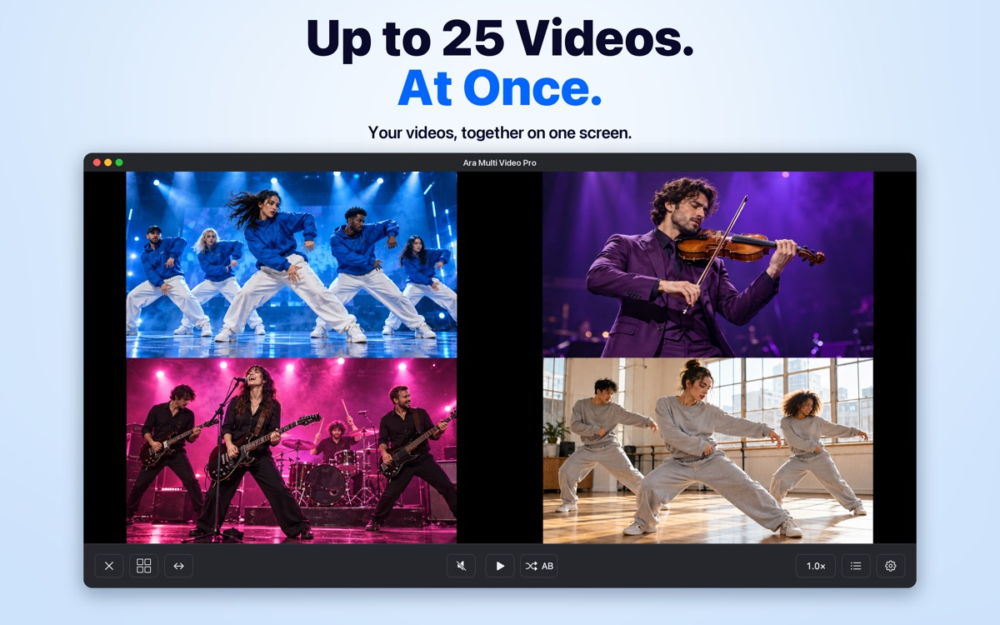

# 아라멀티비디오 플레이어

아라멀티비디오 플레이어는 여러 동영상을 한 화면에서 동시에 재생할 수 있는 플레이어입니다.

홈페이지: [아라멀티비디오 플레이어](https://dalnim.github.io/multivideoplayer/?utm_source=github&utm_medium=referral&utm_campaign=multivideo_download&utm_content=readme)

윈도우와 맥 버전은 100% 무료로 배포합니다.

[맥 버전 다운로드 — Mac App Store](https://apps.apple.com/us/app/aramultivideoplayerpro/id6752816898?mt=12)

윈도우와 맥 버전을 계속 무료로 제공할 수 있도록 아이폰·안드로이드 버전도 다운로드해 주세요.

1. [아이폰 버전 다운로드 — App Store](https://apps.apple.com/app/aramultiplayer/id1629544322)
2. [안드로이드 버전 다운로드 — Google Play](https://play.google.com/store/apps/details?id=com.araonesoft.aramultiplayer)

## 홈페이지 통계와 홍보 링크

홈페이지 통계는 Google Analytics의 `DalPlayer (165430540)` 속성에서 확인합니다.
다운로드 버튼의 주요 이벤트는 `windows_download_click`, `mac_download_click`, `ios_download_click`, `android_download_click`입니다. 버튼 클릭을 측정하며 앱 설치 완료를 의미하지는 않습니다.

개발 중 실제 홈페이지에서 다운로드할 때는 [통계 제외용 홈페이지](https://dalnim.github.io/multivideoplayer/?analytics=off)를 사용합니다. URL에 `analytics=off`가 있으면 Google Analytics 스크립트를 불러오지 않고 방문·클릭 이벤트도 보내지 않습니다. Mac과 Windows에서 이 주소를 북마크해서 사용할 수 있으며, 설정을 브라우저에 저장하지 않으므로 일반 주소로 접속하면 다시 집계됩니다.

외부에 홈페이지를 소개할 때 아래 링크를 사용하면 유입 경로를 구분할 수 있습니다.

| 게시 위치 | 홈페이지 홍보 링크 |
|---|---|
| 유튜브 영상 설명 | [유튜브용 링크](https://dalnim.github.io/multivideoplayer/?utm_source=youtube&utm_medium=video&utm_campaign=multivideo_download&utm_content=description) |
| 블로그 글 | [블로그용 링크](https://dalnim.github.io/multivideoplayer/?utm_source=blog&utm_medium=referral&utm_campaign=multivideo_download&utm_content=post) |
| GitHub README | [GitHub용 링크](https://dalnim.github.io/multivideoplayer/?utm_source=github&utm_medium=referral&utm_campaign=multivideo_download&utm_content=readme) |

Google Analytics의 **보고서 → 수명 주기 → 획득 → 트래픽 획득**에서 `세션 소스/매체`와 `세션 캠페인`으로 유입을 확인하고, 주요 이벤트를 각 다운로드 클릭으로 선택해 성과를 비교합니다. 여러 영상이나 글을 구별하려면 `utm_content`를 게시물별 이름으로 바꿉니다. 홈페이지 내부 링크나 다운로드 버튼에는 이 홍보용 UTM을 붙이지 않습니다.
